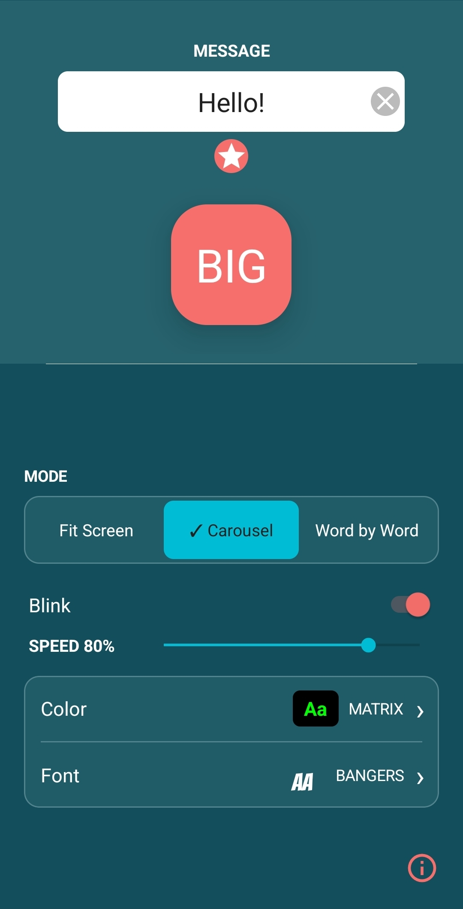

# Big Word

Big Word turns your Android screen into a sign. Type a message and tap **BIG** to show it full screen.

[Get it on Google Play](https://play.google.com/store/apps/details?id=br.com.taparelli.bigword) · [Download the v4.0 APK](https://github.com/dtaparelli/bigword/releases/download/v4.0/bigword-v4.0.apk)

- Fit the whole message on screen, scroll it across, or show one word at a time.
- Pick a font and color palette, adjust the speed, or turn on Blink.
- Save messages as favorites for later.



## Build

Open this folder in Android Studio with JDK 17 and Android SDK 36 installed. Run the app on a device or emulator with Android 7.0 (API 24) or newer.

From the command line, with `ANDROID_HOME` pointing to the Android SDK:

```sh
./gradlew :app:assembleDebug :app:lintDebug
```

On Windows, use `gradlew.bat`. The debug APK is at `app/build/outputs/apk/debug/app-debug.apk`. It uses the `.debug` application ID suffix, so it can be installed alongside the Play Store build.

Big Word v4 is written in Kotlin and uses Android's built-in views. Messages, favorites, and settings are stored on the device.

## Third-party licenses

See [third-party notices](app/src/main/assets/licenses/THIRD_PARTY_NOTICES.md) for the bundled fonts, icons, and tooling.

## License

Big Word is licensed under the [MIT License](LICENSE). Bundled third-party components retain their respective licenses, listed above.

## Releases

To build the optimized release APK and Android App Bundle:

```sh
./gradlew :app:assembleRelease :app:bundleRelease
```

Configure your own signing key in Android Studio to distribute a signed build. Keep signing keys and passwords outside Git.
